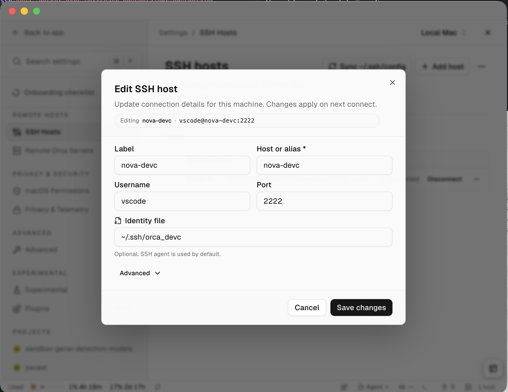
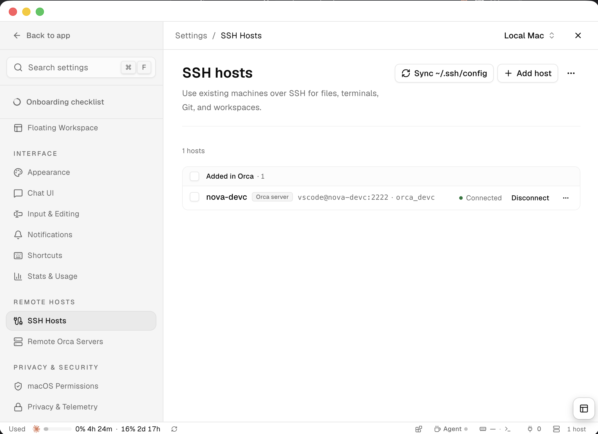
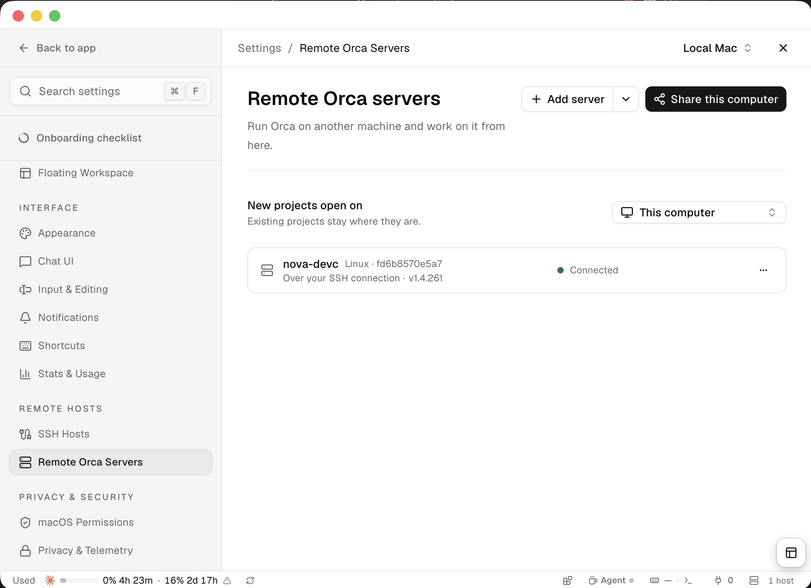
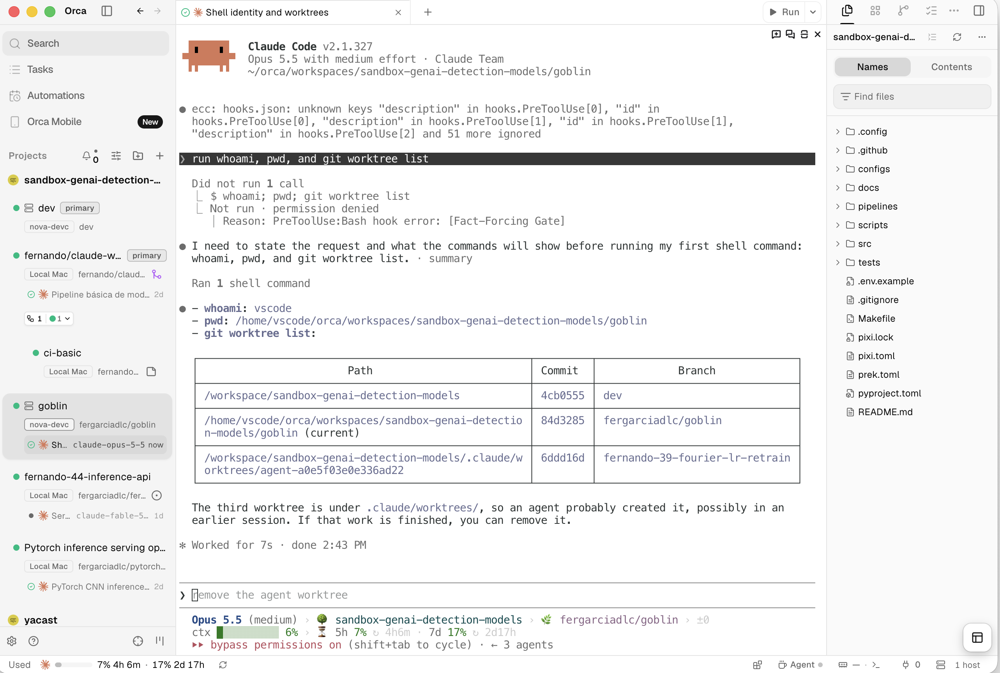

# ORCA with a devcontainer on a VM

This guide connects the [ORCA](https://onorca.dev) desktop app on your Mac to the devcontainer on your VM. ORCA's editor and diffs run on the Mac. The Claude agents and the git worktrees run inside the container, so yolo mode keeps the same sandbox described in [TLDR section 9](../TLDR.md#9-why-yolo-mode-is-safe-here).

ORCA starts its agents on whatever host it connects to. If you point it at the VM itself, Claude runs on the VM, outside the container. So ORCA has to reach the container directly, and the container needs its own SSH server:

```
Mac (ORCA) --ssh--> <vm>:22 --tunnel--> 127.0.0.1:<port> on the VM --> sshd in the devcontainer (user vscode)
```

The container port is published on the VM's loopback address only, and your Mac reaches it with `ProxyJump` through your normal VM login. No Tailscale is needed.

Before you start, you need:

- A working devcontainer on the VM (TLDR sections 1 to 8).
- An entry for the VM in your Mac's `~/.ssh/config` that you can already `ssh` into.
- ORCA installed on your Mac.

The commands below use these placeholders:


| Placeholder   | Meaning                                                      | Example                                 |
| ------------- | ------------------------------------------------------------ | --------------------------------------- |
| `<vm>`        | The VM's `Host` name in your Mac's `~/.ssh/config`           | `nova`                                  |
| `<project>`   | Absolute path on the VM of the folder where you ran `devc .` | `/sandbox-shared/fernando/workspace`    |
| `<port>`      | A free port on the VM, one per container                     | `2222`                                  |
| `<container>` | The container name from `docker ps` on the VM                | `workspace_devcontainer-devcontainer-1` |


## 1. Create an SSH key for the container (Mac)

```bash
ssh-keygen -t ed25519 -f ~/.ssh/orca_devc -C orca-devc
cat ~/.ssh/orca_devc.pub
```

Use this key only for the container. If it leaks, you delete one line on the VM and your other keys are untouched. A passphrase is optional; ORCA asks for it on first use.

Copy the line that `cat` prints. You need it in the next step.

## 2. Create the folders on the VM

Run this in a normal SSH session on the VM, not inside the container.

Create every folder and file that the container will mount **before** you rebuild. If a mount source is missing, Docker creates it as an empty directory owned by `root`, and you need `sudo` to remove it.

```bash
# Public key that the container's sshd will accept
mkdir -p ~/.ssh/devc && chmod 700 ~/.ssh/devc
echo "ssh-ed25519 AAAA... orca-devc" > ~/.ssh/devc/authorized_keys   # paste your line from step 1
chmod 600 ~/.ssh/devc/authorized_keys

# ORCA worktrees and ORCA server identity
cd <project>
mkdir -p .orca-worktrees .orca-home/orca
chmod 700 .orca-home
```

Check the result:

```bash
ls -l ~/.ssh/devc/authorized_keys          # must start with -rw------- (a file, not a directory)
ls -ld .orca-worktrees .orca-home/orca     # owner must be you, not root
```

If `<project>` is a git repo, add `.orca-worktrees/` and `.orca-home/` to its `.gitignore`.

## 3. Edit the devcontainer files (VM)

Edit the files in `<project>/.devcontainer/` on the VM. Inside the container this folder is read-only, so Claude can't change its own sandbox.

### devcontainer.json: add the sshd feature

```json
"features": {
  "ghcr.io/devcontainers/features/github-cli:1": {},
  "ghcr.io/devcontainers/features/sshd:1": {}
},
```

The feature installs OpenSSH in the container and starts it on port 2222.

### devcontainer.json: add the mounts

Add these lines to the end of the `"mounts"` list. Keep the existing lines, and check the commas: every line except the last one ends with a comma.

```json
"source=${localEnv:HOME}/.ssh/devc/authorized_keys,target=/home/vscode/.ssh/authorized_keys,type=bind,readonly",
"source=${localWorkspaceFolder}/.orca-worktrees,target=/home/vscode/orca,type=bind",
"source=${localWorkspaceFolder}/.orca-home/orca,target=/home/vscode/.orca,type=bind"
```


| Container path                      | Contents                                   | Without the mount                                                     |
| ----------------------------------- | ------------------------------------------ | --------------------------------------------------------------------- |
| `/home/vscode/.ssh/authorized_keys` | Your public key from step 1 (read-only)    | sshd rejects your key after every rebuild                             |
| `/home/vscode/orca`                 | ORCA's worktrees (`~/orca/workspaces/...`) | A rebuild deletes your worktrees                                      |
| `/home/vscode/.orca`                | ORCA server identity and keys              | ORCA refuses to reconnect after a rebuild (`orcad_identity_mismatch`) |


ORCA always creates remote worktrees under `~/orca/workspaces` on the host it connects to. There is no per-host setting for this, which is why the folder is mounted from the VM.

### docker-compose.yml: publish the port on the VM's loopback

```yaml
services:
  devcontainer:
    # ...existing settings...
    ports:
      - "127.0.0.1:<port>:2222"
```

Always use `127.0.0.1`. With `0.0.0.0` the container's sshd is open to the network.

### Dockerfile: allow key login only

Add this block **before** the `USER vscode` line. Only root can write to `/etc/ssh`.

```dockerfile
# Orca SSH: allow key login only
RUN mkdir -p /etc/ssh/sshd_config.d && \
  printf '%s\n' \
    'PasswordAuthentication no' \
    'KbdInteractiveAuthentication no' \
    'PermitRootLogin no' \
    'AllowUsers vscode' \
  > /etc/ssh/sshd_config.d/00-orca-keys-only.conf
```

The sshd feature enables password login. The `vscode` password is locked in the base image, so a password login fails anyway, but this block makes sure sshd never asks. sshd reads `sshd_config.d/` first, and the first value it reads wins, so this file takes priority over the feature's settings.

## 4. Rebuild and check (VM)

```bash
cd <project>
devc rebuild
```

Check that the port is published on the loopback address only:

```bash
docker ps --format '{{.Names}}\t{{.Ports}}' | grep <port>
# expected: <container>   127.0.0.1:<port>->2222/tcp
```

Check the sshd settings:

```bash
docker exec -u root <container> sshd -T | grep -Ei '^(passwordauthentication|kbdinteractiveauthentication|permitrootlogin|allowusers)'
```

Expected output (any order):

```
passwordauthentication no
kbdinteractiveauthentication no
permitrootlogin no
allowusers vscode
```

Check that a password login is refused:

```bash
ssh -p <port> -o PubkeyAuthentication=no \
    -o StrictHostKeyChecking=no -o UserKnownHostsFile=/dev/null \
    vscode@127.0.0.1
```

This must end with `Permission denied (publickey)`. If you get a password prompt, press `Ctrl+C` and check that the Dockerfile block is above `USER vscode`.

## 5. Add the SSH entry (Mac)

Add this to `~/.ssh/config` on your Mac:

```
Host <vm>-devc
    HostName 127.0.0.1
    Port <port>
    User vscode
    ProxyJump <vm>
    IdentityFile ~/.ssh/orca_devc
    IdentitiesOnly yes
    ForwardAgent no
    HostKeyAlias <vm>-devc
```

Keep `ForwardAgent no`. If your Mac's ssh-agent is forwarded into the container, Claude in yolo mode can use every key in it, including your GitHub keys. Leave the `<vm>` entry in place too: `ProxyJump` needs it.

`HostKeyAlias` gives the container its own entry in `known_hosts`. Without it, every container would be stored as `127.0.0.1`.

Now add the container's host key. These commands read the key through your existing VM login, so you don't have to compare fingerprints by hand:

```bash
KEY=$(ssh <vm> 'docker exec <container> cat /etc/ssh/ssh_host_ed25519_key.pub' | awk '{print $1" "$2}')
ssh-keygen -R <vm>-devc
echo "<vm>-devc $KEY" >> ~/.ssh/known_hosts
```

Test the connection:

```bash
ssh <vm>-devc 'whoami; claude --version; git --version'
```

You should see `vscode`, the Claude Code version and the git version.

## 6. Connect ORCA

1. In ORCA, open **Settings > SSH Hosts**. If `<vm>-devc` isn't listed, click **Sync \~/.ssh/config** to import it, or click **Add host** and fill in the form:
   
   | Field         | Value              |
   | ------------- | ------------------ |
   | Label         | `<vm>-devc`        |
   | Host or alias | `<vm>-devc`        |
   | Username      | `vscode`           |
   | Port          | `<port>`           |
   | Identity file | `~/.ssh/orca_devc` |
   

    Use the alias from step 5 as the host, not `127.0.0.1`. ORCA looks the alias up in `~/.ssh/config`, so the `ProxyJump` through the VM still applies.
   > 
2. On the `<vm>-devc` row, click **Connect**. The first connection installs the ORCA server inside the container, which takes a few seconds. When it's done, the row shows the **Orca server** label and **Connected**.
   > 

    The same server shows up in **Settings > Remote Orca Servers** as a Linux machine reached "Over your SSH connection". This is also where you choose **Forget...** if you ever need to pair again.
   > 
3. Add a project on the `<vm>-devc` host. Use a repo under `/workspace`, for example `/workspace/my-repo`. Everything under `/workspace` is `<project>` on the VM; anything outside it is deleted by a rebuild.
4. Create a worktree, start a Claude agent in it and ask it to `run whoami, pwd, and git worktree list`. You should see `vscode`, a working directory under `/home/vscode/orca/workspaces/`, and the main checkout under `/workspace`.
   > 

    In the sidebar, projects tagged `<vm>-devc` run in the container and projects tagged **Local Mac** run on your Mac. 

To clone private repos inside the container, `GH_TOKEN` needs access to them (TLDR section 3). If one container holds several repos, the token needs access to all of them.

### Don't run agents on the VM itself

If ORCA also lists `<vm>` as a host, don't start agents on it. They would run on the VM, outside the sandbox. If ORCA was connected to the VM before:

1. On the `<vm>` row, click **Disconnect**.
2. In **Settings > Remote Orca Servers**, open **...** on `<vm>` and choose **Forget...**.
3. In **Settings > SSH Hosts**, remove the `<vm>` row. This doesn't change your `~/.ssh/config`.

The old ORCA files on the VM (`~/.orca`, `~/.orca-remote` and an empty `~/orca`) can then be deleted. Run `pgrep -af "$HOME/\.orca"` on the VM first: it should print nothing.

## 7. Rebuilds


| After `devc rebuild`                | What happens                                                  |
| ----------------------------------- | ------------------------------------------------------------- |
| Repos in `/workspace` and worktrees | Kept                                                          |
| ORCA pairing                        | Kept. Click **Connect** in ORCA.                              |
| ORCA runtime (`~/.orca-remote`)     | Reinstalled automatically on the next connect (a few seconds) |
| Running agents                      | Stopped. Finish or stop them before you rebuild.              |
| Container host key                  | Can change (see below)                                        |


The sshd feature generates the host key while Docker builds the image. When Docker reuses its cache, the key stays the same. When it builds those layers again (for example after a Dockerfile change), you get a new key and SSH refuses to connect. Run the host key commands from step 5 again.

`devc .` and `devc template` overwrite `Dockerfile`, `docker-compose.yml` and `devcontainer.json` with the template. They keep the mounts but drop the sshd feature, the port and the Dockerfile block. If you run either of them, redo step 3. `devc rebuild` and `devc update` don't touch your edits.

## 8. More than one container

Each container needs its own VM port and its own SSH entry. For a second container on port 2223:

- In its `docker-compose.yml`: `"127.0.0.1:2223:2222"`
- On your Mac: copy the `Host` block, rename it (for example `<vm>-ws`), and change `Port` and `HostKeyAlias`.

Both containers can mount the same `~/.ssh/devc/authorized_keys`. Each container needs its own `.orca-worktrees` and `.orca-home`, which is automatic because they live in each project folder.

A shared workspace container (README, Pattern B) holds several repos behind one ORCA host, which is the simplest setup if you work on many repos.

## 9. Troubleshooting


| Symptom                                                                    | Cause                                                                                              | Fix                                                                                                                      |
| -------------------------------------------------------------------------- | -------------------------------------------------------------------------------------------------- | ------------------------------------------------------------------------------------------------------------------------ |
| `Host key verification failed` or `REMOTE HOST IDENTIFICATION HAS CHANGED` | The container got a new host key                                                                   | Run the host key commands from step 5                                                                                    |
| `Permission denied (publickey)` when you connect from the Mac              | `authorized_keys` is missing in the container, or Docker created it as a directory                 | See "authorized\_keys is a directory" below                                                                              |
| Password prompt in step 4                                                  | The Dockerfile block is missing or below `USER vscode`                                             | Fix the Dockerfile, then `devc rebuild`                                                                                  |
| ORCA shows `orcad_identity_mismatch`                                       | The ORCA server was reinstalled with a new identity, usually because the `.orca` mount was missing | Check the mount, then in **Settings > Remote Orca Servers** choose **Forget...** on the host and click **Connect** again |
| Worktrees are gone after a rebuild                                         | The `/home/vscode/orca` mount is missing                                                           | Add the mount (step 3) and rebuild                                                                                       |
| `port is already allocated` during rebuild                                 | Another container uses the same VM port                                                            | Pick another port in `docker-compose.yml` and in `~/.ssh/config`                                                         |


### authorized_keys is a directory

Check from your Mac:

```bash
ssh <vm> 'docker exec <container> ls -l /home/vscode/.ssh/'
```

If the line for `authorized_keys` starts with `d`, the file didn't exist when the container started. Docker created it (and possibly `~/.ssh/devc`) as an empty `root`-owned directory. On the VM:

```bash
cd <project>
devc down
sudo rmdir ~/.ssh/devc/authorized_keys ~/.ssh/devc   # rmdir only removes empty directories
```

Then repeat step 2 and run `devc rebuild`.

## 10. Quick reference


| What                             | Where | Command                                                                   |
| -------------------------------- | ----- | ------------------------------------------------------------------------- |
| Test the connection              | Mac   | `ssh <vm>-devc 'whoami'`                                                  |
| Show the container name and port | VM    | `docker ps --format '{{.Names}}\t{{.Ports}}'`                             |
| Check the sshd settings          | VM    | `docker exec -u root <container> sshd -T | grep -i auth`                  |
| Refresh the host key             | Mac   | The host key commands at the end of step 5                                |
| Re-pair ORCA                     | ORCA  | **Settings > Remote Orca Servers > ... &gt; Forget...**, then **Connect** |
